# Iris profiling figures — 2026-11-08

These figures show existing FPGA operator measurements and separate functional
full-model diagnostics. They do not establish full-model speedups, physical unit
busy time, or a calibrated cycle model. The data contains **180 FPGA observations
forming 90 matched pairs**, and **61 full-model functional attribution groups**.
The additive software phase totals were checked across **440 measured repeats**.

## Speedup and latency by model part

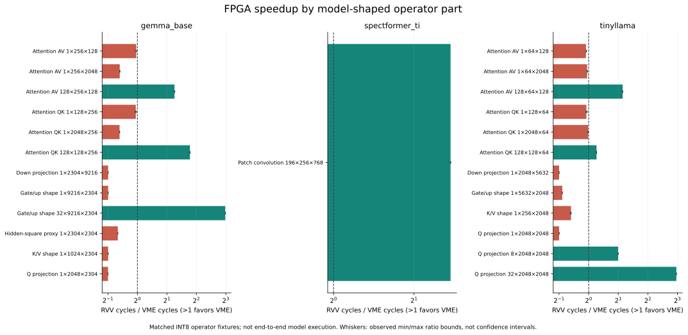

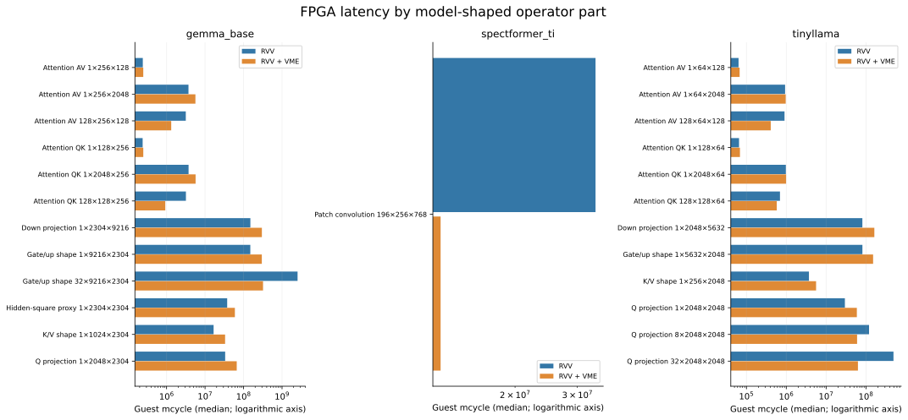

These two figures use the fixed `tuned_i8` cohort: signed INT8 synthetic inputs
at model-derived geometries, with the fit-selected R2/LMUL2/Npanel256 RVV
baseline and matched INT8 VME. They do not select the fastest observation from
multiple cohorts. Speedup is RVV median cycles divided by VME median cycles;
whiskers are observed min/max ratio bounds, not confidence intervals.

Labels show M×N×K. Q/O, K/V and gate/up aliases represent equivalent geometry,
not separately measured model calls. The hidden-square proxy is explicitly
labeled as a proxy. Attention shapes are representative operator fixtures.
Do not sum these partial cases to estimate end-to-end model latency.

## Per-part software costs and throughput efficiency

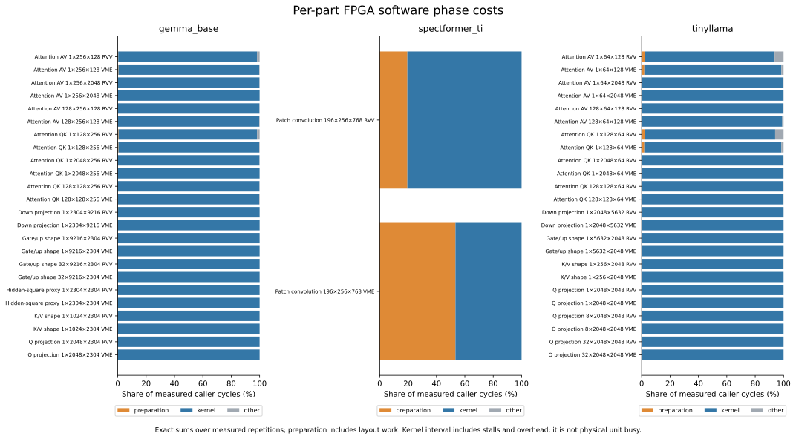

Phase fractions use exact sums over measured repetitions, not subtraction of
independently computed medians. Preparation includes the recorded layout work;
the kernel interval includes compute, stalls and software overhead. A kernel
interval is not unit busy time. For the SpectFormer patch-convolution geometry,
packing remains a substantial cost.

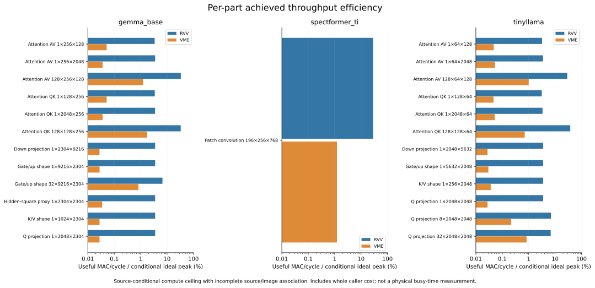

The denominator is a **conditional source compute ceiling**, not measured busy
time: 4 I16→I32 widening MACs/core edge for the current RVV instruction family,
and 256 INT8 MACs/core edge for VME with available operands and accepted work.
Source-to-programmed-image attestation is incomplete. The source assumptions,
clock domain, arithmetic and hashes accompany every ceiling. Low achieved
throughput identifies a gap; it does not alone identify its causal stall.

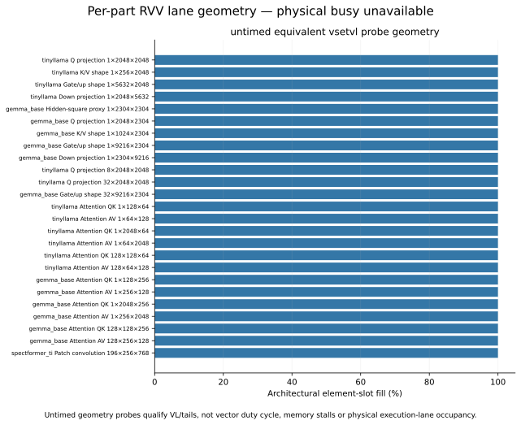

Most lane-fill values here come from untimed equivalent `vsetvl` loop probes.
They establish architectural element-slot coverage, not active vector time.
Full vector lengths can coexist with low throughput due to waits and overhead.

## Roofline view

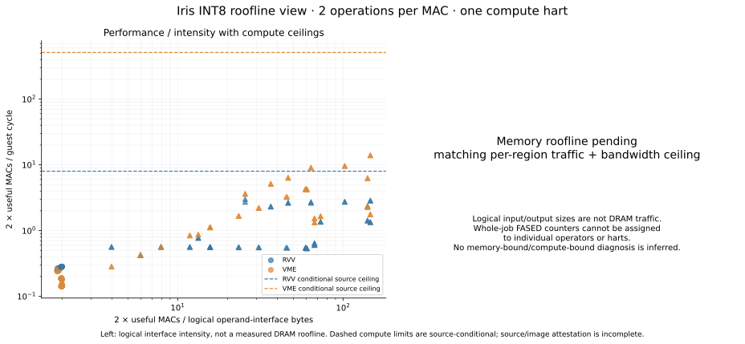

The left panel plots **2 useful integer operations per MAC per guest cycle**
against **2 useful operations per logical operand-interface byte**. It includes
source-conditional compute ceilings and points from the recorded cohorts.
One-row cases use circles; larger-M cases use triangles. This is an intensity
proxy, not measured DRAM traffic or a memory-bound classification.

The memory-boundary panel is deliberately pending. Per-region bytes at the same
boundary and a matching bandwidth/clock ceiling are required before drawing
memory slopes. Whole-job FASED accepted beats cannot be assigned to operators.
The tool supports matched `measured_boundary_bytes`/`traffic_boundary` records;
it never substitutes logical operand sizes for measured boundary traffic.

## Shape ablation and compiler diagnostics

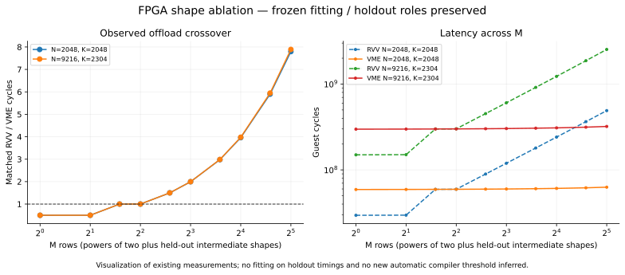

Powers of two and intermediate holdout M values retain their frozen historical
roles. The plot performs no fitting and creates no automatic offload threshold.

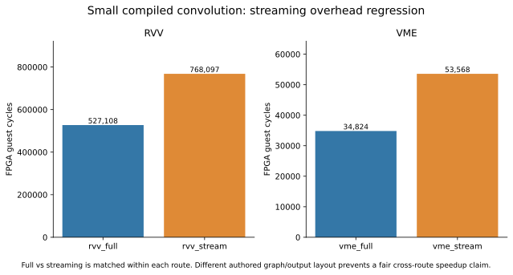

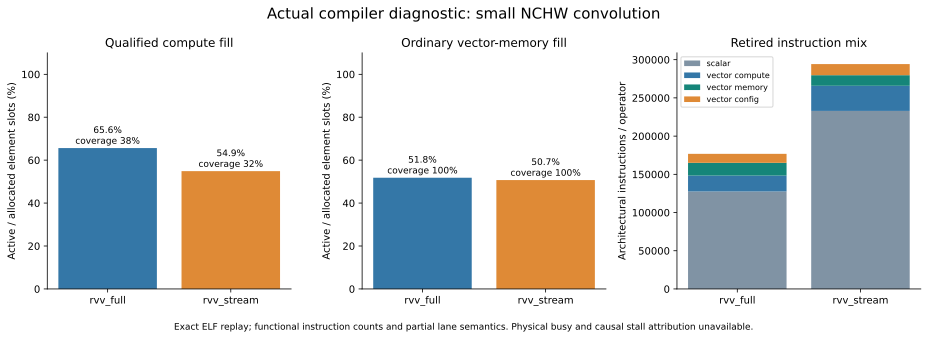

These compiler figures use the exact small NCHW convolution ELF from the
12-region FPGA job. Full versus streaming is matched within each route;
authored graphs and output layouts differ across routes, so this packet does
not qualify an RVV-versus-VME speedup. The architectural replay preserved all
original outputs, guards and CSR endpoints. Compute lane semantics cover only
38%/32% of RVV compute instructions; uncovered reductions/moves/permutations
are excluded, not assigned fabricated lane activity. Architectural instruction
counts are not modeled cycles. These figures predate the new copy optimization.

## Full-model and memory diagnostics

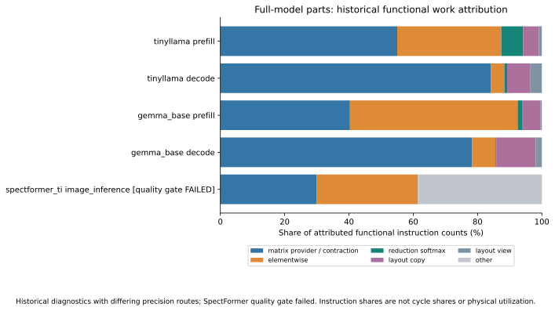

Full-model bars show attributed **functional instruction counts**, not cycle
shares or physical utilization. TinyLlama/Gemma use historical FP8-VME with
floating residual operations; SpectFormer uses a distinct historical INT8/F32
diagnostic whose quality gate failed. It remains visibly labeled. This is not
the current end-to-end INT8-versus-mixed comparison certificate.

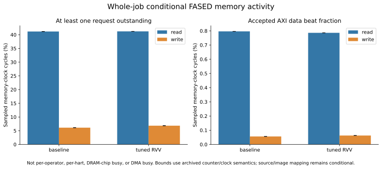

Memory activity bounds are whole-job, sampled memory-clock quantities under
archived RTL/counter/clock assumptions. Outstanding-request fraction, accepted
AXI beat fraction, DRAM-chip busy and DMA busy are different quantities. No
per-part or per-hart attribution is inferred from these counters.

## Reproduce and export

From the repository root, with Python 3.12 and an isolated environment:

```sh
python3 -m venv /tmp/iris-plot-env
/tmp/iris-plot-env/bin/pip install -r tools/profiling/requirements.txt
/tmp/iris-plot-env/bin/python tools/profiling/plot_profiles.py \
  --data docs/profiling/20261108/records.json \
  --diagnostics docs/profiling/20261108/diagnostics.json \
  --output /tmp/iris-profile-figures-new
```

The output directory must not exist. Each figure is exported as PNG, SVG and
PDF, with an output inventory and source digests. Published SVG snapshots are
included here; JSON and CSV retain the underlying observations and scopes.
`validation.json` describes the collector checks; `plot-receipt.json` binds the
rendered figure bytes. No hardware access is needed to reproduce plots.

## Further plots and evidence needed

The planned set additionally includes scheduling heatmaps (panel size, LMUL,
unrolling, buffering), an overlap timeline, multicore scaling/load balance,
full-model latency/throughput, quality-performance tradeoffs, per-region
Spike/FPGA signed error, workspace tradeoffs, and explicit DMA transfer profiles.
Physical busy/causal stalls require qualifying counters; multicore claims need
new one/two-compute-hart measurements. New optimized binaries require fresh
native and managed FPGA gates before hardware speedups can be reported.
